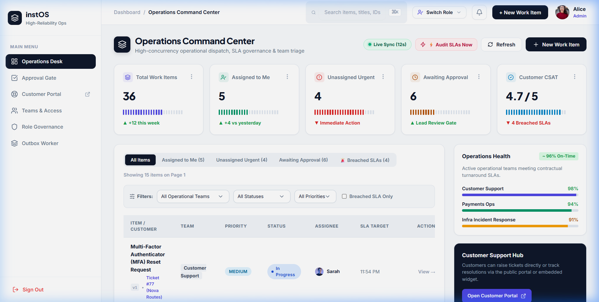
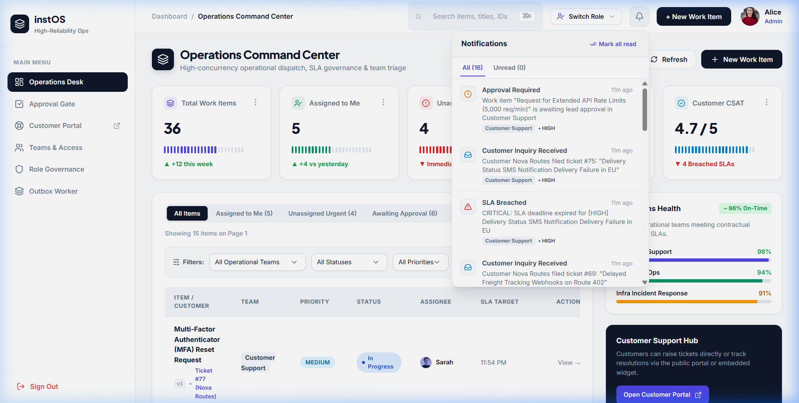
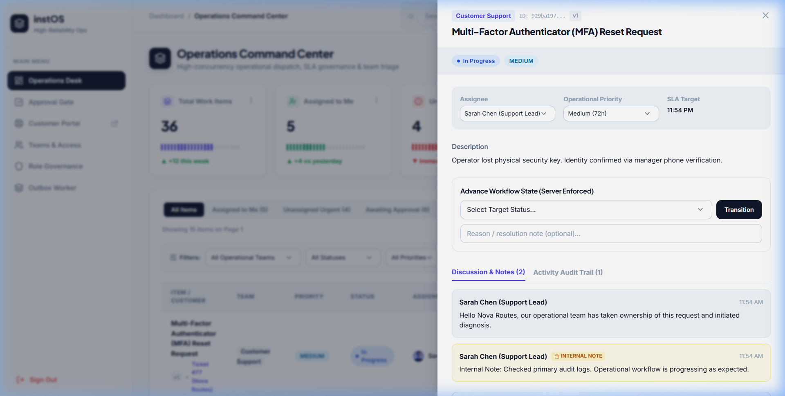
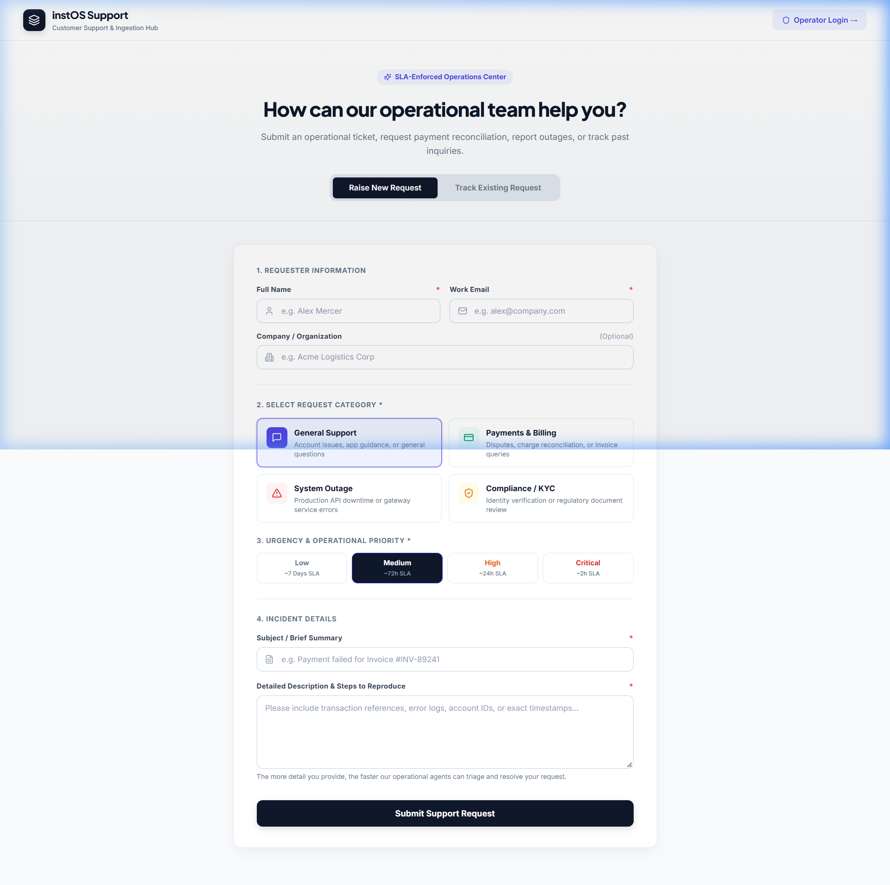
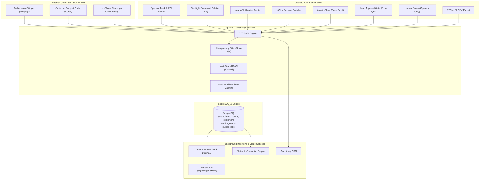

# instOS — Operations & Customer Support Platform

> **Newtonite Software Engineering Challenge — Operations Under Pressure**  
> High-Reliability Operations Engine & Public Ingestion Hub with Real Concurrency Controls

instOS is a high-reliability, full-stack operational workflow platform engineered for volatile enterprise environments where teams coordinate mission-critical incidents, high-risk payment disputes, regulatory compliance flags, and customer escalations under heavy concurrency.

Unlike conventional closed-loop tools that only serve internal back-offices, instOS features a **Dual-Surface Architecture**: a public **Customer Support Portal & Drop-in Embeddable Widget** integrated with an internal **Operator Command Center** equipped with race-condition proof claims, optimistic version locking, server-enforced approval gates, an autonomous SLA auto-escalation engine, and a reliable transactional outbox worker.

---

## 🎥 Live Interactive Walkthrough


---

## 🌐 Live Deployments & Endpoints

| Environment | Live URL | Description |
| :--- | :--- | :--- |
| **Production Web App** | [https://instos.inistnt.in](https://instos.inistnt.in) | Complete React 18 + Vite frontend on custom domain |
| **Customer Support Portal** | [https://instos.inistnt.in/portal](https://instos.inistnt.in/portal) | Public ticket submission, file upload & token tracking |
| **Operator Command Desk** | [https://instos.inistnt.in](https://instos.inistnt.in) | Enterprise dispatch desk with 1-click role switcher & notifications |
| **Production API (Railway)** | [https://newtonite-ops-23131180345-production.up.railway.app](https://newtonite-ops-23131180345-production.up.railway.app) | Express + Prisma + PostgreSQL 16 backend |
| **Live Health Check** | [https://newtonite-ops-23131180345-production.up.railway.app/health](https://newtonite-ops-23131180345-production.up.railway.app/health) | Reports status of DB, Redis, Resend & Cloudinary |
| **Drop-in Embed Widget** | `https://instos.inistnt.in/widget.js` | Drop-in operational support script for any website |
| **GitHub Repository** | [prakhar-developer/newtonite-ops-23131180345](https://github.com/prakhar-developer/newtonite-ops-23131180345) | Complete monorepo source code & test suites |

---

## 📸 Product Tour & Core Capabilities

### 1. Operator Command Center
*Real-time operational dispatch desk featuring dynamic KPI cards, 5 instant quick-view preset pills, multi-dimensional team/status/priority filters, 1-click SLA Audit scan trigger, and RFC-4180 CSV export for compliance audits.*



---

### 2. In-App Notification Center (`Bell` Flyout)
*Real-time aggregated notifications with unread badge counter, polling every 15s. Alerts operators of SLA breaches, lead approvals required, tickets assigned to them, and customer comments. Clicking any item deep-links directly via URL param `?item=id`.*



---

### 3. 1-Click Role Switcher (Live RBAC Testing)
*Allows reviewers and operators to seamlessly test permissions without logging out. Instantly switch between Super Admin (Alice Walker), Payments Lead (Marcus Brody), Support Member (James Wilson), and Read-Only Viewer (Victoria Vance).*


---

### 4. Work Item Detail & Immutable Audit Timeline
*Slide-out inspection drawer displaying live SLA target countdown, optimistic version locking, atomic claim action, dual-channel discussion (operator-only internal notes vs customer messages), and complete tamper-proof activity history.*



---

### 5. Public Customer Support Portal (`/portal`)
*External customer-facing portal where end-users submit support requests, track ticket status in real-time via cryptographic tracking tokens, and submit CSAT star ratings (1-5) upon resolution.*



---

## 🏛️ System Architecture



---

## ⚡ Concurrency & Correctness Guarantees

| Pressure Scenario | Engineered Solution | Automated Test Verification |
| :--- | :--- | :--- |
| **Concurrent claims** | Atomic conditional update (`UPDATE work_items SET assigneeId = :user WHERE id = :id AND assigneeId IS NULL`). Colliding claim receives `409 Conflict`. | `tests/concurrency.test.ts` fires simultaneous claims; strictly 1 succeeds. |
| **Stale version edits** | Optimistic locking on integer `version` field. Mismatch returns `409 Conflict` with latest server snapshot and triggers the frontend `ConflictDrawer` for visual reconciliation. | `tests/concurrency.test.ts` asserts stale edits are rejected with diff metadata. |
| **Repeated requests (network retries, double-clicks)** | `Idempotency-Key` header with SHA-256 fingerprinting. Replays cached response with `Idempotent-Replay: true`. Tampered payload returns `409`. | `tests/idempotency.test.ts` verifies single creation on retries. |
| **Workflow rules & Approval gate** | Server-enforced state machine (`OPEN -> IN_PROGRESS -> AWAITING_APPROVAL -> RESOLVED -> CLOSED`). Advancing to `RESOLVED` strictly requires `LEAD`/`ADMIN`, and assignee cannot approve own work (Four-Eyes rule). | `tests/workflow.test.ts` verifies invalid jumps and Four-Eyes rule. |
| **Resource-level authorization** | Multi-team RBAC (`Viewer`, `Member`, `Lead`, `Admin`). Cross-team item access returns `404 Not Found` to prevent resource enumeration. | `tests/rbac.test.ts` verifies cross-team isolation and viewer mutation blocks. |
| **Reliable async outbox** | Side-effects written to `outbox_jobs` in primary transaction. Poller uses `SKIP LOCKED`, exponential backoff, and DLQ. | Verified in `apps/api/src/modules/outbox/outbox.worker.ts`. |
| **Deterministic SLA Escalation** | Scheduled + 1-click manual trigger scanning expired tickets (`min(dueDate, slaDeadline)`), setting `slaBreached = true`, incrementing version, and emitting audit logs. | Verified in `apps/api/src/services/sla.service.ts`. |

---

## 👥 Demo Personas & Evaluation Credentials

The application features a **1-Click Role Switcher** in the top navigation bar of the Operator Desk and Spotlight Command Palette to test authorization and approval gates instantly without typing passwords.

- **Master Password for all demo accounts**: `password123`

| Persona | Email | System Role & Teams | Key Evaluation Capability |
| :--- | :--- | :--- | :--- |
| **Alice Walker** | `admin@instos.dev` | **Super Admin** (All Teams) | Global administration, team provisioning, Outbox inspection |
| **Sarah Chen** | `lead.support@instos.dev` | **Support Lead** (Customer Support) | Review and approve transitions to Resolved (Four-Eyes gate) |
| **James Wilson** | `member.support@instos.dev` | **Support Member** (Customer Support) | Claim unassigned items, triage customer tickets, resolve |
| **Marcus Brody** | `lead.payments@instos.dev` | **Payments Lead** (Payments Ops) | High-risk settlement review, lead approval gate |
| **Elena Rostova** | `member.payments@instos.dev` | **Payments Member** (Payments Ops) | Investigate chargebacks and payment disputes |
| **Victoria Vance** | `viewer@instos.dev` | **Viewer** (Read-Only across teams) | Verify mutation blocks (`403 Forbidden` on claims and edits) |

---

## 🔌 Drop-In Website Widget (`widget.js`)

Any external website or corporate portal can drop in the instOS operational support widget with a single `<script>` tag:

```html
<!-- Drop in before </body> on any external website -->
<script src="https://instos.inistnt.in/widget.js"></script>
```

Optional customization attributes:
```html
<script 
  src="https://instos.inistnt.in/widget.js"
  data-api-url="https://newtonite-ops-23131180345-production.up.railway.app/api/v1"
  data-portal-url="https://instos.inistnt.in"
  data-team="support">
</script>
```

Features included in the widget:
- Floating launcher button with badge animations.
- Embedded ticket submission form with category and urgency pickers.
- Base64 screenshot/file attachment uploading directly to Cloudinary.
- Instant tracking token generation with deep link to the customer portal.
- Search and track status directly inside the floating widget.

---

## ☁️ Production Cloud Integrations

instOS is configured with real production cloud services and zero-config local simulation fallbacks:

1. **Transactional Email (Resend API)**:
   - Configured with live API key and verified custom domain: `support@inistnt.in`.
   - Outbox worker dispatches ticket creation notices and status updates with customer tracking links.
   - Fallback: Local Nodemailer Ethereal simulation with logged preview URLs when unconfigured.

2. **Attachment & Screenshot Storage (Cloudinary CDN)**:
   - Configured with production Cloudinary cloud `sglfwp5c`.
   - Streams screenshots and document attachments to Cloudinary's secure CDN.
   - Fallback: Local disk storage in `/uploads` directory when unconfigured.

3. **Database & Cache (PostgreSQL 16 & Redis)**:
   - Hosted on Railway PostgreSQL with automatic schema synchronization and deterministic auto-seeder.
   - Sliding-window rate limiter protecting public ticket endpoints with Redis / in-memory fallback.

---

## 🛠️ Running Locally

### Prerequisites
- **Node.js**: `v20+`
- **npm**: `v10+`
- **PostgreSQL**: Local Postgres 16 instance or Docker

### Quick Setup

```bash
# 1. Clone repository
git clone https://github.com/prakhar-developer/newtonite-ops-23131180345.git
cd newtonite-ops-23131180345

# 2. Install dependencies (links local packages)
npm install

# 3. Configure environment
cp .env.example .env

# 4. Generate Prisma client & push schema
npm run db:push
npm run db:seed

# 5. Start dev server (API on :4000, Web on :5173)
npm run dev
```

- **Operations Desk**: [http://localhost:5173](http://localhost:5173)
- **Customer Portal**: [http://localhost:5173/portal](http://localhost:5173/portal)
- **API Health Check**: [http://localhost:4000/health](http://localhost:4000/health)

### Running via Docker Compose (1-Command Evaluation)

```bash
docker compose up --build
```
- Starts PostgreSQL 16 container with healthchecks.
- Builds and runs the unified instOS application container.
- Automatically pushes the Prisma schema and seeds the rich 36-item multi-team operational dataset.
- Access the platform at **http://localhost:4000**.

---

## 🧪 Running Automated Tests

```bash
npm test
```

Runs the full Vitest integration suite against real PostgreSQL:
- `tests/concurrency.test.ts` (Atomic claim race condition + optimistic version CAS)
- `tests/idempotency.test.ts` (Duplicate request replay + payload tampering check)
- `tests/workflow.test.ts` (Illegal jumps + member approval block + Four-Eyes rule + lead approval)
- `tests/rbac.test.ts` (404 isolation across teams + viewer mutation block)

**Result**: 10/10 tests pass in ~1.8 seconds.

---

## 🛡️ Reviewer & Interview Discussion Guide

### 1. 60-Second Architecture Overview
> **Client (Portal / Widget / Ops Desk)** &rarr; **Express Gateway** &rarr; **Idempotency Filter (SHA-256)** &rarr; **RBAC Service (404/403)** &rarr; **Workflow State Machine** &rarr; **PostgreSQL 16** &rarr; **Transactional Outbox Worker (`SKIP LOCKED`)** &rarr; **Resend API / Cloudinary CDN**.
> All critical state transitions and audit logs are committed within the **exact same ACID database transaction**, guaranteeing that history can never diverge from reality.

### 2. Failure Scenarios & Resilience
* **Database Down**: The health check endpoint immediately reports `503 Service Unavailable (database: disconnected)`. Mutations fail cleanly without leaving orphaned records.
* **Worker Crashes Mid-Job**: The Outbox Worker leases jobs with a timestamp. A crash recovery sweeper automatically reclaims jobs stranded in `PROCESSING` status for over 5 minutes.
* **Network Retries / Double Clicks**: Every mutation accepts an `Idempotency-Key` header with SHA-256 fingerprinting. The server returns the cached response with `Idempotent-Replay: true`, eliminating duplicate work items.
* **Two Operators Colliding**: 
  - **Claim Collision**: Atomic conditional update (`WHERE id = :id AND assignee_id IS NULL`). Exactly 1 query updates a row (`200 OK`); the colliding query updates 0 rows and returns `409 Conflict`.
  - **Stale Version Edit**: Optimistic locking checks `version = :seenVersion`. Mismatches return `409 Conflict` with the latest snapshot, triggering the frontend `ConflictDrawer` for side-by-side reconciliation.

### 3. Key Design Decisions & Assumptions
* **Four-Eyes Verification**: A Lead can never approve their own work item when advancing to `RESOLVED` (enforced on server).
* **Resource Isolation**: Accessing an item outside your authorized teams returns `404 Not Found` rather than `403 Forbidden` to prevent resource existence enumeration attacks.
* **Whole-Item Locking**: If two operators update different fields simultaneously, the second write is rejected with `409` rather than silently merging to guarantee deterministic audit consistency.

### 4. What Changes at 10x Scale?
1. **Read Replicas**: Route high-frequency dashboard queries (`GET /items`, `/kpis`) to PostgreSQL read replicas.
2. **Table Partitioning**: Partition `activity_events` and `outbox_jobs` tables by monthly `createdAt` ranges to keep active indexes in memory.
3. **Change Data Capture (CDC)**: Replace periodic `SKIP LOCKED` outbox polling with Debezium and Apache Kafka for sub-millisecond event streaming.
4. **Real-Time Push**: Integrate WebSockets / Server-Sent Events (SSE) to update operator screens instantly without client polling.

---

## 📚 Documentation Index

- [Architecture & Decisions](ENGINEERING_DECISIONS.md) — Deep dive into concurrency, outbox, and RBAC trade-offs.
- [Known Limitations & Scope Boundaries](KNOWN_LIMITATIONS.md) — Production limits and enterprise scaling considerations.
