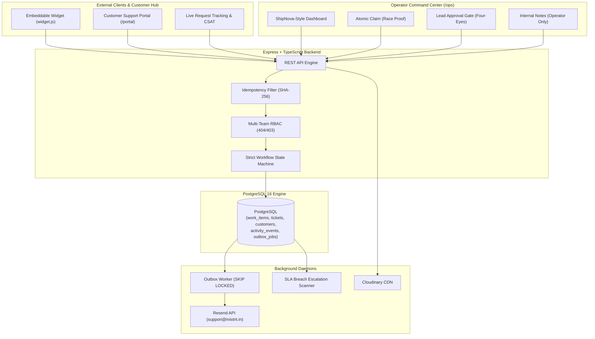

# instOS — Operations & Customer Support Platform

> **Newtonite Software Engineering Challenge — Operations Under Pressure**  
> High-Reliability Operations Engine & Public Ingestion Hub with Real Concurrency Controls

instOS is a full-stack operational workflow platform designed for high-concurrency enterprise environments where teams coordinate mission-critical incidents, payment disputes, compliance flags, and customer requests. 

Unlike conventional closed-loop tools, instOS features a **Dual-Surface Architecture**: an external **Customer Support Portal & Embeddable Widget** seamlessly integrated with an internal **Operator Command Center** equipped with race-condition proof claims, optimistic locking, server-enforced approval gates, and a reliable transactional outbox worker.

---

## Live Deployments & Endpoints

| Environment | Live URL | Description |
| :--- | :--- | :--- |
| **Production Web App** | [https://instos.inistnt.in](https://instos.inistnt.in) | Complete React 18 + Vite frontend on custom domain |
| **Customer Support Portal** | [https://instos.inistnt.in/portal](https://instos.inistnt.in/portal) | Public ticket submission, file upload & token tracking |
| **Operator Command Desk** | [https://instos.inistnt.in/ops](https://instos.inistnt.in/ops) | ShipNova-style triage desk with 1-click role switcher |
| **Production API (Railway)** | [https://newtonite-ops-23131180345-production.up.railway.app](https://newtonite-ops-23131180345-production.up.railway.app) | Express + Prisma + PostgreSQL 16 backend |
| **Live Health Check** | [https://newtonite-ops-23131180345-production.up.railway.app/health](https://newtonite-ops-23131180345-production.up.railway.app/health) | Reports status of DB, Redis, Resend & Cloudinary |
| **Drop-in Embed Widget** | `https://instos.inistnt.in/widget.js` | Drop-in operational support script for any website |
| **GitHub Repository** | [prakhar-developer/newtonite-ops-23131180345](https://github.com/prakhar-developer/newtonite-ops-23131180345) | Complete monorepo source code & test suites |

---

## Architecture Diagram



---

## Demo Personas & Evaluation Credentials

The application features a **1-Click Role Switcher** on the top navigation bar of the Operator Desk (`/ops`) and the login screen to test live authorization, team isolation, and approval gates instantly without typing credentials.

- **Master Password for all demo accounts**: `password123`

| Persona | Email | System Role & Teams | Key Evaluation Capability |
| :--- | :--- | :--- | :--- |
| **Alice Walker** | `admin@instos.dev` | **Super Admin** (All Teams) | Team provisioning, user role assignments, Outbox inspection |
| **Sarah Chen** | `lead.support@instos.dev` | **Support Lead** (Customer Support) | Review and approve transitions to Resolved (Four-Eyes gate) |
| **James Wilson** | `member.support@instos.dev` | **Support Member** (Customer Support) | Claim unassigned items, triage customer tickets, resolve |
| **Marcus Brody** | `lead.payments@instos.dev` | **Payments Lead** (Payments Ops) | High-risk settlement review, lead approval gate |
| **Elena Rostova** | `member.payments@instos.dev` | **Payments Member** (Payments Ops) | Investigate chargebacks and payment disputes |
| **Victoria Vance** | `viewer@instos.dev` | **Viewer** (Read-Only across teams) | Verify mutation blocks (`403 Forbidden` on claims and edits) |

---

## Critical Behaviors Beyond CRUD (All Tested)

| Situation | Engineered Solution | Automated Test Verification |
| :--- | :--- | :--- |
| **Concurrent claims** | Atomic conditional update (`UPDATE work_items SET assigneeId = :user WHERE id = :id AND assigneeId IS NULL`). Colliding claim receives `409 Conflict`. | `tests/concurrency.test.ts` fires simultaneous claims; strictly 1 succeeds. |
| **Stale version edits** | Optimistic locking on integer `version` field. Mismatch returns `409 Conflict` with latest server snapshot and triggers UI conflict drawer. | `tests/concurrency.test.ts` asserts stale edits are rejected with metadata. |
| **Repeated requests** | `Idempotency-Key` header with SHA-256 fingerprinting. Replays cached response with `Idempotent-Replay: true`. | `tests/idempotency.test.ts` verifies single creation on retries. |
| **Workflow rules & Approval gate** | Server-enforced state machine. Advancing from `AWAITING_APPROVAL` to `RESOLVED` strictly requires `LEAD`/`ADMIN`, and assignee cannot approve own work (Four-Eyes rule). | `tests/workflow.test.ts` verifies invalid jumps and Four-Eyes rule. |
| **Resource-level authorization** | Multi-team RBAC (`Viewer`, `Member`, `Lead`, `Admin`). Cross-team item access returns `404 Not Found` to prevent enumeration. | `tests/rbac.test.ts` verifies cross-team isolation and viewer blocks. |
| **Reliable async outbox** | Side-effects written to `outbox_jobs` in primary transaction. Poller uses `SKIP LOCKED`, exponential backoff, and DLQ. | Verified in `apps/api/src/modules/outbox/outbox.worker.ts`. |

---

## Drop-In Website Widget (`widget.js`)

Any external website or corporate portal can drop in the instOS operational support widget with a single `<script>` tag:

```html
<!-- Drop in before </body> on any external website -->
<script src="https://instos.inistnt.in/widget.js"></script>
```

Optional customization attributes:
```html
<script 
  src="https://instos.inistnt.in/widget.js"
  data-api-url="https://newtonite-ops-23131180345-production.up.railway.app/api/v1"
  data-portal-url="https://instos.inistnt.in"
  data-team="support">
</script>
```

Features included in the widget:
- Floating launcher button with badge animations.
- Embedded ticket submission form with category and urgency pickers.
- Base64 screenshot/file attachment uploading directly to Cloudinary.
- Instant tracking token generation with deep link to the customer portal.
- Search and track status directly inside the floating widget.

---

## Production Cloud Integrations

instOS is configured with real cloud services and zero-config local simulation fallbacks:

1. **Transactional Email (Resend API)**:
   - Configured with live API key and verified custom domain: `support@inistnt.in`.
   - Outbox worker dispatches ticket creation notices and status updates with customer tracking links.
   - Fallback: Local Nodemailer Ethereal simulation with logged preview URLs when unconfigured.

2. **Attachment & Screenshot Storage (Cloudinary CDN)**:
   - Configured with production Cloudinary cloud `sglfwp5c`.
   - Streams screenshots and document attachments to Cloudinary's secure CDN.
   - Fallback: Local disk storage in `/uploads` directory when unconfigured.

3. **Database & Cache (PostgreSQL 16 & Redis)**:
   - Hosted on Railway PostgreSQL with automatic schema synchronization and deterministic auto-seeder.
   - Sliding-window rate limiter protecting public ticket endpoints with Redis / in-memory fallback.

---

## Running Locally

### Prerequisites
- **Node.js**: `v20+`
- **npm**: `v10+`
- **PostgreSQL**: Local Postgres 16 instance or Docker

### Quick Setup

```bash
# 1. Clone repository
git clone https://github.com/prakhar-developer/newtonite-ops-23131180345.git
cd newtonite-ops-23131180345

# 2. Install dependencies (links local packages)
npm install

# 3. Configure environment
cp .env.example .env

# 4. Generate Prisma client & push schema
npm run db:push
npm run db:seed

# 5. Start dev server (API on :4000, Web on :5173)
npm run dev
```

- **Operations Desk**: [http://localhost:5173/ops](http://localhost:5173/ops)
- **Customer Portal**: [http://localhost:5173/portal](http://localhost:5173/portal)
- **API Health Check**: [http://localhost:4000/health](http://localhost:4000/health)

---

## Running Automated Tests

```bash
npm test
```

Runs the full Vitest integration suite against real PostgreSQL:
- `tests/concurrency.test.ts` (Atomic claim race condition + optimistic version CAS)
- `tests/idempotency.test.ts` (Duplicate request replay + payload tampering check)
- `tests/workflow.test.ts` (Illegal jumps + member approval block + Four-Eyes rule + lead approval)
- `tests/rbac.test.ts` (404 isolation across teams + viewer mutation block)

**Result**: 10/10 tests pass in ~1.8 seconds.

---

## Documentation Index

- [Architecture & Decisions](ENGINEERING_DECISIONS.md) — Deep dive into concurrency, outbox, and RBAC trade-offs.
- [Known Limitations & Roadmap](KNOWN_LIMITATIONS.md) — Production limits and enterprise scaling considerations.
