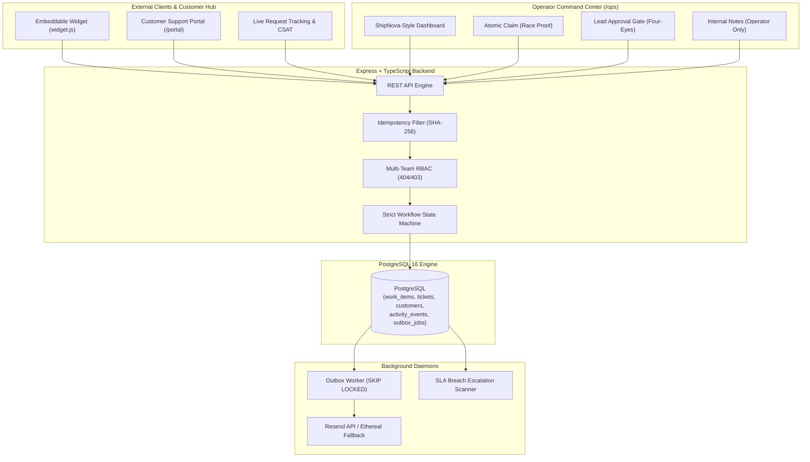

# instOS — Operations & Customer Support Platform

> **Newtonite Software Engineering Challenge — Operations Under Pressure**  
> High-Reliability Operations Engine & Public Ingestion Hub with Real Concurrency Controls

instOS is a full-stack operational workflow platform designed for high-concurrency enterprise environments where teams coordinate mission-critical incidents, payment disputes, compliance flags, and customer requests. 

Unlike conventional closed-loop tools, instOS features a **Dual-Surface Architecture**: an external **Customer Support Portal & Embeddable Widget** seamlessly integrated with an internal **Operator Command Center** equipped with race-condition proof claims, optimistic locking, server-enforced approval gates, and a reliable transactional outbox worker.

---

## Architecture Diagram



---

## Quick Start (Run Locally in 2 Minutes)

### Prerequisites
- **Node.js**: `v20+`
- **npm**: `v10+`
- **PostgreSQL**: Local Postgres or Docker Compose

### Option A: Running with Local Node & Postgres

```bash
# 1. Install dependencies
npm install

# 2. Setup database schema & seed demo data
npx prisma generate
npm run db:push
npm run db:seed

# 3. Start API backend and Web frontend simultaneously
npm run dev
```

- **Operations Command Center**: [http://localhost:5173](http://localhost:5173)
- **Public Customer Support Portal**: [http://localhost:5173/portal](http://localhost:5173/portal)
- **Backend API**: [http://localhost:4000/api/v1](http://localhost:4000/api/v1)

### Option B: Running with Docker Compose

```bash
docker compose up --build
```

---

## Demo Personas & Credentials

The web application features a **1-Click Role Switcher** on the top bar to test live authorization and RBAC boundaries instantly without typing.

| Email | Password | Role & Assigned Teams | Purpose / Evaluation Use Case |
| :--- | :--- | :--- | :--- |
| `admin@instos.dev` | `password123` | **Super Admin** (All Teams) | Team creation, user role governance, Outbox monitor |
| `lead.support@instos.dev` | `password123` | **Support Lead** (Customer Support) | Review and approve transitions to Resolved |
| `member.support@instos.dev` | `password123` | **Support Member** (Customer Support) | Claim unassigned items, triage customer tickets |
| `lead.payments@instos.dev` | `password123` | **Payments Lead** (Payments Ops) | High-risk settlement review, lead approval gate |
| `member.payments@instos.dev` | `password123` | **Payments Member** (Payments Ops) | Investigate chargebacks and payment disputes |
| `viewer@instos.dev` | `password123` | **Viewer** (Read-Only across all teams) | Verify mutation rejections (`403 Forbidden` on claims/edits) |

---

## Critical Behaviors Beyond CRUD (All Tested)

| Situation | Engineered Solution | Automated Test Suite |
| :--- | :--- | :--- |
| **Concurrent claims** | Atomic conditional update (`UPDATE work_items SET assigneeId = :user WHERE id = :id AND assigneeId IS NULL`). Colliding claim receives `409 Conflict`. | `tests/concurrency.test.ts` fires simultaneous claims; strictly 1 succeeds. |
| **Stale version edits** | Optimistic locking on integer `version` field. Mismatch returns `409 Conflict` with latest server snapshot and triggers UI conflict drawer. | `tests/concurrency.test.ts` asserts stale edits are rejected with metadata. |
| **Repeated requests** | `Idempotency-Key` header with SHA-256 fingerprinting. Replays cached response with `Idempotent-Replay: true`. | `tests/idempotency.test.ts` verifies single creation on retries. |
| **Workflow rules & Approval gate** | Server-enforced state machine. Advancing from `AWAITING_APPROVAL` to `RESOLVED` strictly requires `LEAD`/`ADMIN`, and assignee cannot approve own work. | `tests/workflow.test.ts` verifies invalid jumps and Four-Eyes rule. |
| **Resource-level authorization** | Multi-team RBAC (`Viewer`, `Member`, `Lead`, `Admin`). Cross-team item access returns `404 Not Found` to prevent enumeration. | `tests/rbac.test.ts` verifies cross-team isolation and viewer blocks. |
| **Reliable async outbox** | Side-effects written to `outbox_jobs` in primary transaction. Poller uses `SKIP LOCKED`, exponential backoff, and DLQ. | Verified in `apps/api/src/modules/outbox/outbox.worker.ts`. |

---

## Free-Tier Cloud Deployment Guide

### 1. Deploy Backend & Database on Railway
1. Create a new project on [Railway](https://railway.app).
2. Add **PostgreSQL** from the Railway template gallery.
3. Deploy the backend from your GitHub repository using the included `Dockerfile`.
4. Set environment variables:
   - `DATABASE_URL`: `${{Postgres.DATABASE_URL}}`
   - `JWT_SECRET`: Generate a 32+ character random secret
   - `RESEND_API_KEY`: *(Optional)* Your free Resend key from [resend.com](https://resend.com)
   - `CLOUDINARY_CLOUD_NAME`: *(Optional)* From [cloudinary.com](https://cloudinary.com)
   - `CLOUDINARY_API_KEY`: *(Optional)*
   - `CLOUDINARY_API_SECRET`: *(Optional)*

### 2. Deploy Frontend on Vercel
1. Import repository into [Vercel](https://vercel.com).
2. Root directory: `.`
3. Build command: `npm run build:web`
4. Output directory: `apps/web/dist`
5. Environment variable: `VITE_API_URL=https://your-railway-app.up.railway.app/api/v1`

---

## Drop-In Website Widget (`widget.js`)

Any external website can embed the instOS support widget with two lines of HTML:

```html
<script 
  src="https://your-domain.com/widget.js" 
  data-api-url="https://your-domain.com/api/v1" 
  data-team="support">
</script>
```

---

## Running Automated Tests

```bash
npm test
```

Runs the full Vitest integration suite covering concurrency, idempotency, workflow state rules, and resource-level RBAC.
